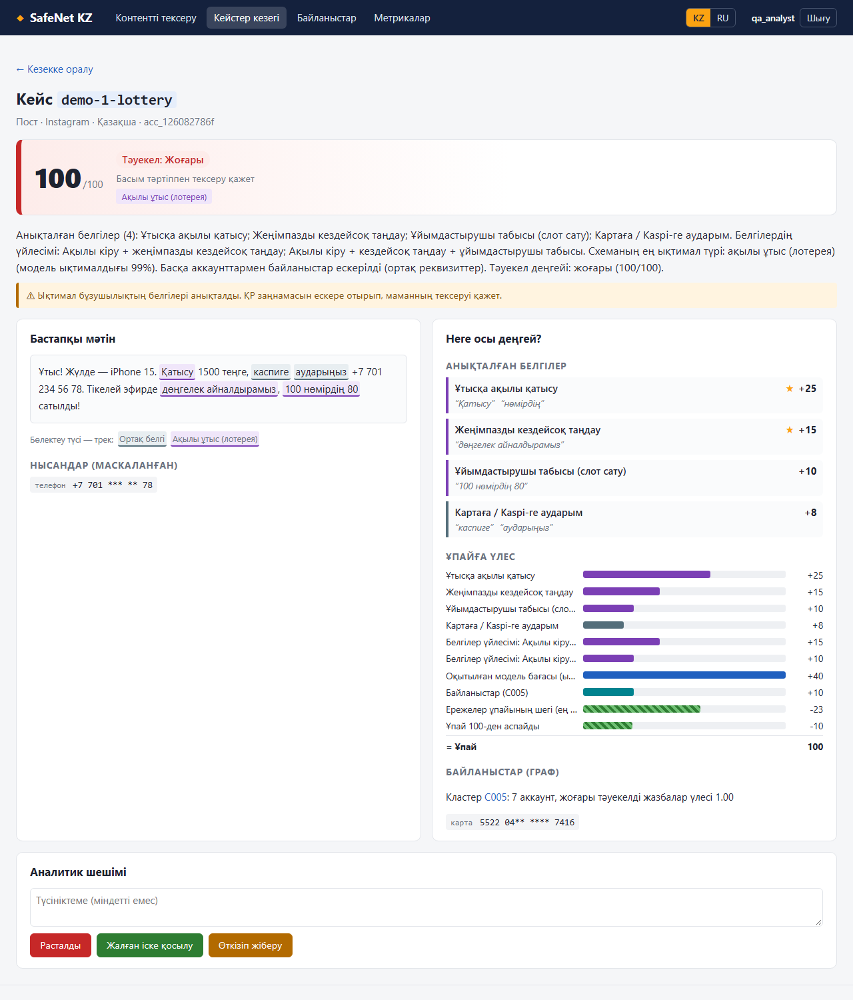
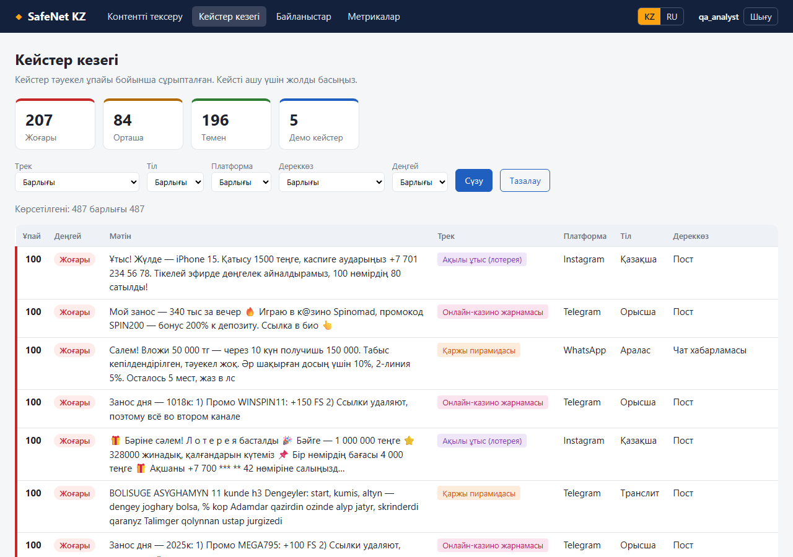
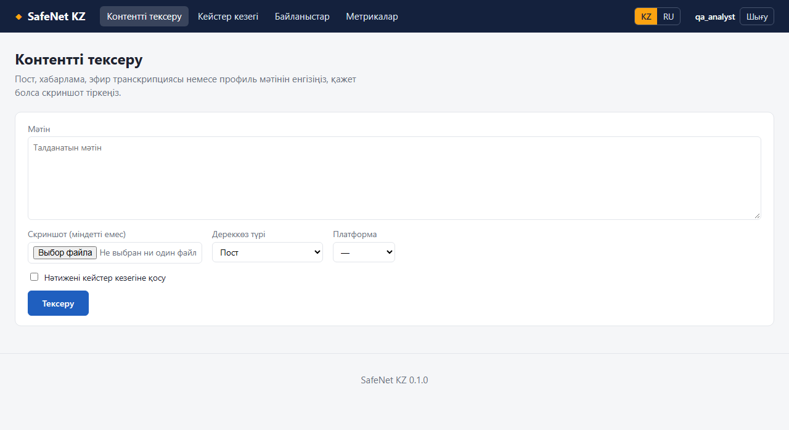
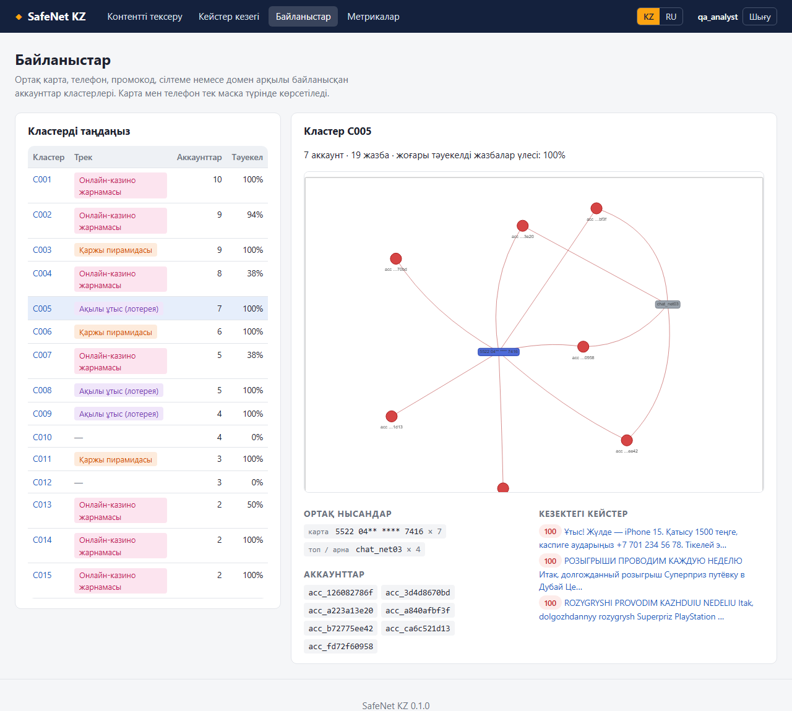
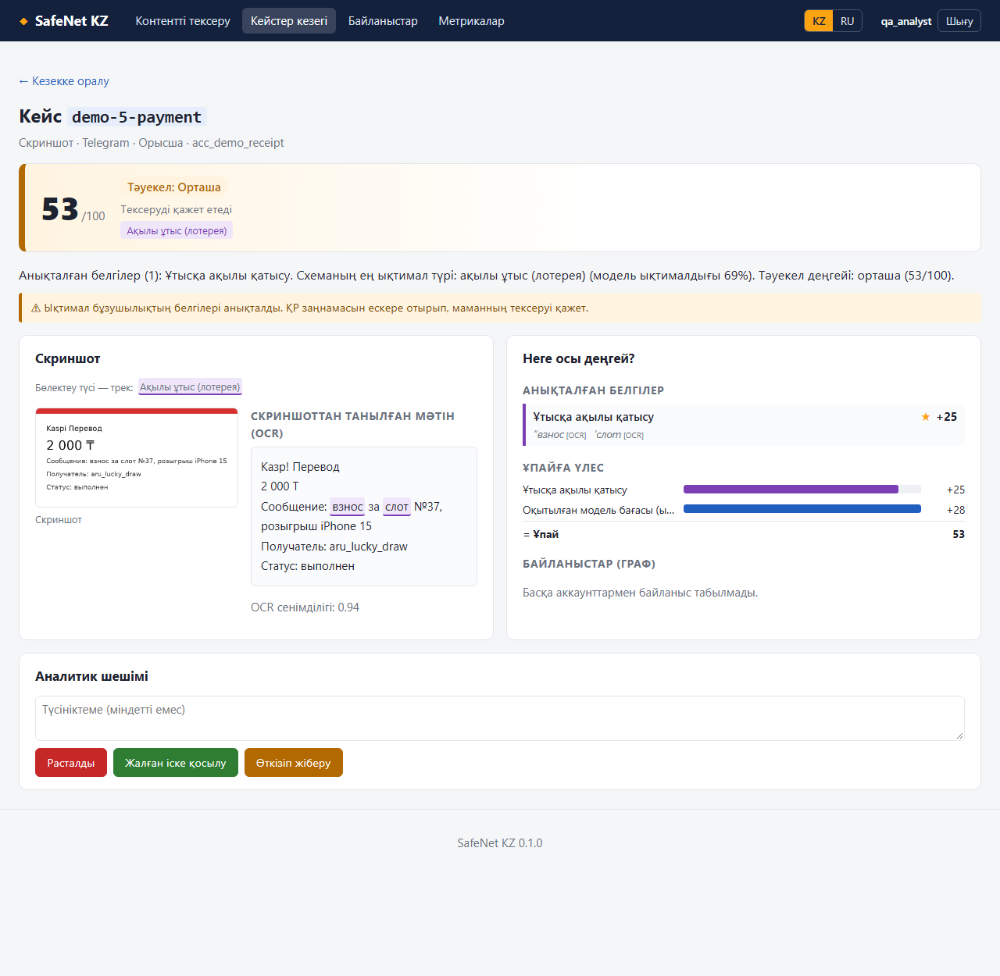

# SafeNet KZ

Әлеуметтік желілердегі контентте үш түрлі схеманың **белгілерін** табатын жүйе (MVP):

- ақылы ұтыстар (лотереялар);
- онлайн-казиноның жасырын жарнамасы;
- қаржы пирамидалары.

Ол посттарды, чат хабарламаларын, профиль сипаттамаларын, эфир транскрипцияларын және скриншоттарды (OCR)
талдайды. Тілдер: орыс, қазақ, аралас және транслит. Бүркемелеуді («к@зинo», «Л о т е р е я») де өңдейді.

Әр нәтижеде бар:

- тәуекел ұпайы мен деңгейі;
- іске қосылған белгілер және мәтінде бөлектелген дәлелдер;
- ұпайдың құрамдас бөліктері;
- ескерту.

> **Үкім емес, белгілер.** Жүйе кейстерді басымдық бойынша реттейді және себебін түсіндіреді. Шешімді маман
> қабылдайды. Әр нәтижеде мына ескерту тұрады:
>
> «Ықтимал бұзушылықтың белгілері анықталды. ҚР заңнамасын ескере отырып, маманның тексеруі қажет.»

Веб-қабат **Django** негізінде: дашборд — Django шаблондары, API — django-ninja.



## Мүмкіндіктер

- **Белгілер сөздігі.** `config/signals.yaml`-да 27 белгі бар: 4 негізгі, 17 қосымша және 6 төмендететін.
  Әрқайсысының дәлел-фрагменті бар. Пирамида табысы сомалар мен мерзімнен есептеледі.
- **ML-классификатор.** TF-IDF (символдар 2–5 + сөздер 1–2) мен белгі-фичалар, калибрленген логистикалық
  регрессия.
- **Гибрид скоринг.** Салмақтар, белгілер үйлесімі, ML, төмендететін факторлар және желі бонусы. Шектер тек
  валидация бойынша таңдалған.
- **Скриншоттар.** Tesseract (rus+kaz+eng), алдын ала өңдеу және жиі қателерді түзету.
- **Байланыстар графы.** Ортақ карта, телефон, промокод, домен немесе сілтеме арқылы кластерлер құрылады
  (Louvain). Карта мен телефон тек хэш немесе маска түрінде сақталады.
- **Аналитик дашборды (KZ/RU):**
  - кейстер кезегі;
  - дәлелдері бөлектелген кейс карточкасы;
  - контентті тексеру;
  - байланыстар графы;
  - метрикалар;
  - «Расталды / Жалған іске қосылу / Өткізіп жіберу» батырмалары → `data/feedback/feedback.csv`.
- **API.** `POST /analyze`, `/analyze/image`, `/batch`, `GET /health`; OpenAPI құжаты — `/docs`. Кіру bearer-токен арқылы, сұраулар саны шектеледі, `save: true` нәтижені кезекке қосады.
- **Продакшнға дайын.** Логин мен рөлдер (аналитик / бақылаушы), аудит журналы, HTTPS баптаулары, PostgreSQL, waitress/gunicorn: [docs/DEPLOYMENT.md](docs/DEPLOYMENT.md).
- **Бағалау.** test және gold жинақтарында precision, recall, F1 және FPR (қиын негативтерде бөлек). Сонымен
  қатар абляция, PR-қисық және қателерді талдау.

## Жылдам бастау

Талап: Python 3.12+ (бекітілген Django 6.1 мен numpy нұсқалары 3.12-ні талап етеді). OCR үшін [Tesseract](https://github.com/tesseract-ocr/tesseract) 5 қажет, бірақ ол
міндетті емес: онсыз скриншоттар мәтінсіз талданады.

```bash
python -m venv .venv
source .venv/bin/activate   # Windows: .venv\Scripts\activate
make install data train eval app
```

Windows-та GNU make болмаса, сол нысаналарды `make.bat` орындайды:

```bash
make.bat install data train eval app
```

Барлық беттер жүйеге кіруді талап етеді. Сондықтан алғашқы іске қосудан бұрын (немесе басқа терминалда)
әкімші аккаунтын жасаңыз:

```bash
python manage.py createsuperuser
```

Аналитиктерді `/admin/` бетінде қосып, оларға `analyst` немесе `observer` рөлін бересіз.

| команда | не істейді |
|---|---|
| `make install` | тәуелділіктер + `pip install -e .` |
| `make tessdata` | `rus`/`kaz` Tesseract деректерін `models/tessdata`-ға жүктейді |
| `make data` | синтетикалық датасет (2400 жазба, 130 скриншот) және gold-жинақ |
| `make train` | ML-модель, белгілер есебі, val бойынша шектер, байланыстар графы |
| `make eval` | `reports/metrics.md`, `metrics.json`, `errors.md`, графиктер |
| `make app` | әзірлеу сервері: http://127.0.0.1:8000 (кезек бос болса, test жүктеледі) |
| `make demo` | әзірлеу сервері + 5 дайын демо кейс және мысал мәтіндер (`SAFENET_DEMO_MODE=1`) |
| `make serve` | **продакшн сервері** (waitress, `SAFENET_ENV=production`): [docs/DEPLOYMENT.md](docs/DEPLOYMENT.md) |
| `make api` | тек API: http://127.0.0.1:8000/docs |
| `make bench` | өңдеу уақыты және каскад үлестері (`reports/benchmark.md`) |
| `make docs` | құжаттардағы кестелерді конфигтер мен есептерден жаңартады |
| `make test` | барлық тесттер (`make test-stage N=10` — бір кезеңнің тесттері) |

Мысал сұрау (алдымен интеграцияға токен беріледі):

```bash
python manage.py create_api_token my-integration
```

```bash
curl -X POST http://127.0.0.1:8000/analyze -H "Authorization: Bearer sn_..." -H "Content-Type: application/json" \
     --data-binary '{"text": "Вложи 10 000 — через неделю получишь 30 000! Гарантированно, без риска."}'
```

## Метрикалар

Гибрид (ережелер + ML), деңгей ≥ `medium` болса «белгілер бар» деп саналады:

<!-- auto:metrics -->
| жинақ | n | precision | recall | F1 | FPR | FPR (қиын негатив) |
|---|---:|---:|---:|---:|---:|---:|
| test | 482 | 0.972 | 0.969 | 0.970 | 4.1% | 6.4% |
| gold | 122 | 0.975 | 0.987 | 0.981 | 4.5% | 3.4% |

Дереккөз: [`reports/metrics.md`](reports/metrics.md) (`make eval`).
<!-- /auto:metrics -->

- **test** — синтетикалық деректің бөлек фраза тұқымы: оның шаблондары мен фразалары оқытуға кірмейді.
- **gold** — қолмен жазылған 122 хабарлама, тек соңғы бағалауға арналған.

Шектеулерді [METHODOLOGY.md](docs/METHODOLOGY.md#9-шектеулер) бөлімінен қараңыз.

## Скриншоттар

| Кейстер кезегі | Контентті тексеру |
|---|---|
|  |  |
| **Байланыстар** | **Скриншот + OCR** |
|  |  |

Метрикалар беті: [docs/img/metrics.png](docs/img/metrics.png).

## Құрылым

```
app/                Django: settings, urls, dashboard/ (беттер, модельдер, load_cases, load_demo)
src/safenet/        кітапхана
  generator/        синтетикалық деректер және gold
  preprocess/       нормализация, тіл, нысандар
  signals/          белгілер детекторы (config/signals.yaml)
  ml/               ML-классификатор
  scoring/          тәуекел ұпайы, деңгейлер, түсіндірмелер, шектерді таңдау
  multimodal/       OCR және скриншоттар
  graph/            байланыстар графы, кластерлер, pyvis
  eval/             метрикалар, абляция, бенчмарк
  api/              django-ninja API
  pipeline.py       analyze() / analyze_many()
  demo.py           make demo кейстері (config/demo_cases.yaml)
config/             signals.yaml, scoring.yaml, demo_cases.yaml
data/               synthetic/, gold/, images/, demo/, feedback/
models/             clf.joblib, thresholds.json, graph.joblib, tessdata/
reports/            метрикалар мен есептер
docs/               METHODOLOGY, ARCHITECTURE, ROADMAP, PITCH
tests/              test_stageNN_*.py — әр кезеңнің тесттері
```

## Құжаттама

- [docs/METHODOLOGY.md](docs/METHODOLOGY.md):
  - белгілер кестесі мен тәуекел формуласы;
  - шектер және оларды таңдау;
  - жалған іске қосылулармен жұмыс;
  - шектеулер мен этика.
- [docs/ARCHITECTURE.md](docs/ARCHITECTURE.md): масштабтау сызбасы (Kafka, ережелер каскады, OCR пулы) және
  өлшенген уақыт бойынша өткізу қабілеті.
- [docs/ROADMAP.md](docs/ROADMAP.md): пилот → интеграция → қайта оқыту → бейне/аудио → ведомствоаралық алмасу.
- [docs/PITCH.md](docs/PITCH.md): 5 минуттық питч және спикер мәтіні.
- [docs/DEPLOYMENT.md](docs/DEPLOYMENT.md): продакшнда орналастыру — баптаулар, рөлдер, API токендері, логтар, тексеріс тізімі.
- [PROGRESS.md](PROGRESS.md): кезеңдер журналы, тесттер, табылған қателер мен шешімдер.

## Деректер және этика

- **Деректер.** Барлық деректер синтетикалық:
  - карта нөмірлері Лун тексерісінен өтпейді;
  - домендер тек `.test` / `.example`;
  - адамдар тек никнейммен аталады;
  - казино атаулары ойдан шығарылған.
- **Нөмірлер.** Карта мен телефон графта хэш, ал интерфейсте маска түрінде көрсетіледі.
- **Сөздер.** Интерфейс пен түсіндірмелерде айыптау мағынасындағы сөздер қолданылмайды, оны тесттер тексереді.

Лицензия: [MIT](LICENSE).
