# Архитектура және масштабтау

## 1. MVP қазір қалай құрылған

```
                      ┌──────────────────────────── Django (app/) ─────────────────────────────┐
 браузер ───────────► │  дашборд (app/dashboard): кезек, кейс, тексеру, байланыстар, метрикалар │
 сыртқы жүйе ───────► │  API (django-ninja): /analyze, /analyze/image, /batch, /health, /docs    │
                      └───────────────┬─────────────────────────────────────┬──────────────────┘
                                      │ safenet.pipeline.analyze()          │ Case, Feedback (SQLite)
                                      ▼                                     ▼
 safenet (src/):  preprocess → signals → ml → scoring → graph      data/feedback/feedback.csv
                  multimodal (OCR: Tesseract)
 артефактілер:    config/*.yaml · models/clf.joblib · models/thresholds.json · models/graph.joblib
 бағалау:         safenet.eval → reports/metrics.md · safenet.eval.bench → reports/benchmark.md
```

- **Бір кітапхана, екі кіру нүктесі.** Дашборд та, API да бір `safenet.pipeline.analyze()` функциясын
  шақырады. Нәтиже Pydantic схемасы (`AnalysisResult`) бойынша құрылады, сондықтан ол API-да да, дашбордта
  да бірдей.
- **Конфиг кодтан бөлек.** Белгілер, салмақтар, үйлесімдер және шектер YAML/JSON файлдарында. Сөздікті
  өзгерту үшін кодты қайта жазу керек емес.
- **Қайталанатын құрастыру.** `make data train eval` деректерді, модельдерді және есептерді нөлден бірдей
  жасайды (seed бекітілген).

## 2. Өнімдік масштабтау сызбасы

```mermaid
flowchart LR
    subgraph Sources[Коллекторлар]
        A1[Платформа API / серіктестер]
        A2[Ашық арналар мен топтар]
        A3[Азаматтардың шағымдары]
    end
    Sources --> K1[(Kafka: content.raw)]
    K1 --> R[Ережелер каскады<br/>нормализация + белгілер<br/>regex, ~2–3 мс]
    R -- "белгі жоқ (қарапайым контенттің ~90%+)" --> DROP[(тек статистика)]
    R -- "күдікті" --> K2[(Kafka: content.suspicious)]
    K1 -- "сурет" --> IMG[Сурет сүзгісі<br/>perceptual hash, дубликаттар]
    IMG --> OCR[OCR пулы<br/>CPU/GPU]
    OCR --> R
    K2 --> ML[ML + скоринг<br/>батчпен]
    ML --> G[Граф: кластерлер<br/>инкременталды жаңарту]
    G --> DB[(PostgreSQL: кейстер, шешімдер<br/>объект қоймасы: скриншоттар)]
    DB --> UI[Дашборд + API<br/>Django, LB артында]
    UI -- "аналитик шешімі" --> FB[(Kafka: feedback)]
    FB --> TR[Қайта оқыту<br/>сөздік, модель, шектер]
    TR -. "жаңа нұсқа" .-> R
    TR -. "жаңа нұсқа" .-> ML
```



Сатылар:

1. **Коллекторлар.**
   - Платформалардың ресми API-лары немесе серіктестік бағдарламалар (trusted flagger).
   - Ашық арналар мен топтарды бақылау.
   - Азаматтардың шағымдары.

   Әр жазба бірден `content.raw` топигіне түседі. Карта мен телефон нөмірлері осы жерде хэштеледі, ашық түрде
   әрі қарай жіберілмейді.
2. **Kafka.** Партиция кілті — `account_id`. Бір аккаунттың жазбалары бір воркерге ретімен түседі, бұл граф
   үшін маңызды. Топиктер `content.raw`, `content.suspicious` және `feedback` бөлек болғандықтан, әр сатыны
   жеке масштабтауға болады.
3. **Ережелер каскады** — арзан бірінші саты. Ол тек нормализация мен regex-белгілерді орындайды. Бірде-бір
   оң белгі іске қоспаған жазба ML мен OCR-ға жіберілмейді, тек статистикаға жазылады. Өлшеулер:
   - test-тегі схемалардың **100%-ы** келесі сатыға өтті;
   - қарапайым `none` контентінің **96%-дан астамы** сүзілді.

   Нақты сандар 4-бөлімде.
4. **OCR** — ең қымбат саты. Сондықтан ол бөлек пулда жұмыс істейді. Алдында дубликаттар perceptual hash
   арқылы алынып тасталады, себебі бір баннер мыңдаған рет қайталанады. Кейін GPU-да EasyOCR/PaddleOCR
   қолдануға болады.
5. **ML және скоринг** күдікті ағынды батчпен өңдейді. Бір воркерге бір модель жүктеледі.
6. **Граф** кластерлерді инкременталды жаңартады. Жаңа ортақ реквизит пайда болса, тек сол компонент қайта
   есептеледі. Толық Louvain кластерлеуі түнде бір рет орындалады.
7. **Қойма**:
   - PostgreSQL — кейстер, шешімдер, аудит журналы;
   - объект қоймасы — скриншоттар;
   - аналитикалық қойма (мысалы, ClickHouse) — ағын статистикасы мен дрейф мониторингі.
8. **Дашборд және API** — күйсіз (stateless) Django процестері, жүктеме теңестіргіштің артында.
   - Кіру және рөлдер: аналитик, супервайзер, аудитор.
   - Әр әрекет журналға жазылады.
9. **Кері байланыс** аналитиктердің шешімдерін жинайды. Ол сөздік пен модельді қайта оқытуға және шектерді
   қайта таңдауға жұмсалады. Жаңа нұсқа алдымен «көлеңкелі» режимде (shadow) салыстырылады.

## 3. Көлденең масштабтау

- **Воркерлер күйсіз.** Әр саты — Kafka consumer group. Воркерлер санын топиктің лагы бойынша автоматты
  түрде өзгертуге болады, мысалы Kubernetes HPA/KEDA арқылы.
- **Идемпотенттік.** Кілт — мазмұн хэші. Бір жазба қайта келсе, қайта талданбайды.
- **Басымдық.** `high` кейстер аналитик кезегінің басында тұрады. Жүктеме артқанда `low` нәтижелері тек
  статистикада қалады.
- **Модельдер нұсқаланады.** Әр нәтижеде сөздік, модель және шектер нұсқасы сақталады. Қайта оқытудан кейін
  метрикаларды салыстыруға болады.

## 4. Өткізу қабілетін бағалау

Төмендегі сандар осы машинадағы өлшеулер. Оларды `make bench` береді, кестені `make docs` жаңартады.

<!-- auto:bench -->
| өлшем | мәні |
|---|---:|
| ережелер (нормализация + белгілер), мс/жазба | 2.62 |
| ML (батч), мс/жазба | 2.89 |
| толық талдау (OCR-сыз), мс/жазба | 5.68 |
| OCR, мс/скриншот | 367 |
| каскад: схемалардың келесі сатыға жіберілгені | 100.0% |
| каскад: қарапайым `none` сүзілгені | 96.4% |
| каскад: барлық `none` сүзілгені (қиын негативтермен) | 67.5% |
| мысал: шыңдағы ағын, жазба/с | 347 |
| мысал: ML-ға жіберілетін үлес | 33.8% |
| мысал: CPU ядролары — ережелер / ML / OCR | 0.9 / 0.3 / 12.8 |

Машина: Windows 11, 12 логикалық ядро, бір ағын. Толығырақ: [`reports/benchmark.md`](../reports/benchmark.md).
<!-- /auto:bench -->

Қорытындылар:

- **Ережелер мен ML арзан.** Бір ядро секундына жүздеген жазбаны өңдейді. Тәулігіне 10 млн жазба ағынын шыңда
  бірнеше ядро ғана көтереді.
- **Негізгі шығын — OCR.** Скриншоттар ағынның 10%-ы болса, OCR-ға ережелер мен ML-ге қарағанда бірнеше есе
  көп ядро керек. Сондықтан OCR-дың алдында дубликаттар алынады, батч пен GPU қолданылады, ал басымдық
  күдікті аккаунттарға беріледі.
- **Каскадтың басты пайдасы — қымбат сатыларда.** Қазіргі сызықтық модель онсыз да жеңіл. Бірақ болашақтағы
  ауыр сатылар үшін (трансформер-эмбеддингтер, эфирлерді ASR, бейне кадрлары) ағынның тек күдікті бөлігі
  жіберілуі шешуші.
- Бағалау консервативті: бір ағынды Python өлшенді. Мұнда батч бойынша векторлау, процестер пулы және
  `regex`-тің компиляцияланған нұсқалары ескерілмеген.

## 5. Сенімділік және қауіпсіздік

- **Жеке деректер.** Карта мен телефон кіру сатысында SHA-256-мен (тұзбен) хэштеледі. Интерфейсте тек маска
  көрсетіледі. Сақтау мерзімі шектеледі, ескі шикі мәтіндер жойылады, ал белгілер мен шешімдер қалады.
- **Қол жеткізу.** Рөлдерге негізделген қол жеткізу, SSO және барлық қарау/шешім әрекеттерінің аудит журналы.
- **Мониторинг.**
  - Сатылардың лагы және өңдеу уақыты.
  - Белгілердің іске қосылу жиілігі. Кенет өзгерсе, бұл сленг дрейфі болуы мүмкін.
  - Аналитиктер растаған кейстердің үлесі: бұл нақты precision-ның бағасы.
- **Қате толеранттылығы.** Kafka жазбаларды сақтайды. Воркер құласа, жазба басқа воркерге беріледі. OCR
  қолжетімсіз болса, жүйе мәтінмен жұмысын жалғастырады, ал нәтижеге ескерту қосылады (MVP-де бұл бар).
