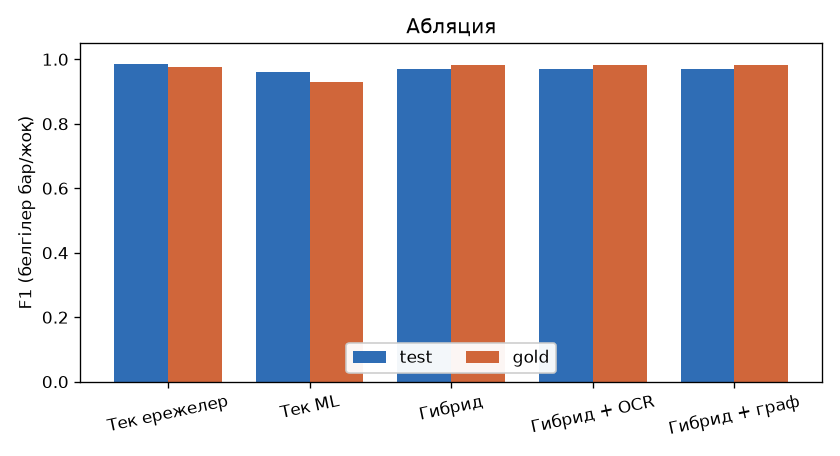
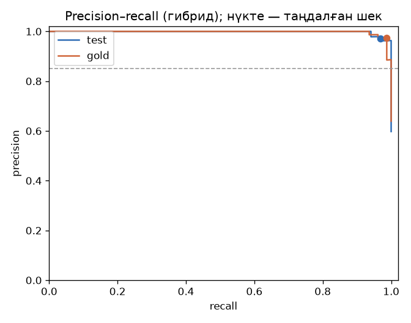
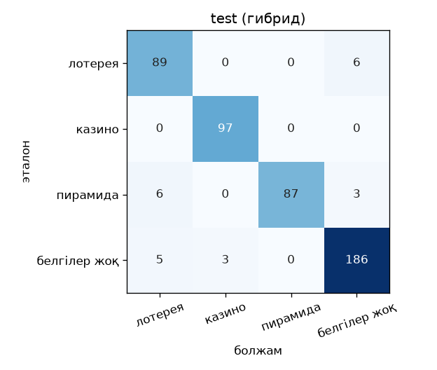
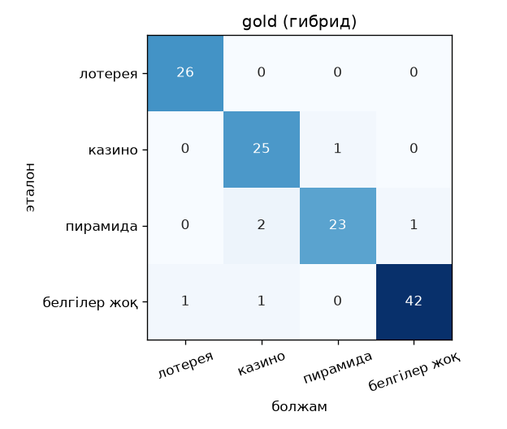

# Бағалау: метрикалар

Барлық сандар бағалау кезінде автоматты түрде есептеледі, қайта есептегенде нәтиже өзгермейді. **test** — синтетикалық деректердің бөлек бөлігі: оның шаблондары мен фразалары модельді оқытуға да, баптауға да қолданылмаған. **gold** — қолмен жазылған 122 хабарлама, олар тек бағалауға қолданылады.

«Белгілер бар» — деңгейі «Орташа» немесе одан жоғары (ұпай ≥ 14); «Жоғары» деңгей — ұпай ≥ 62. Шектер оқытуға қолданылмаған бөлек баптау жинағы бойынша таңдалған.

## Негізгі нәтижелер (гибрид)

| жинақ | n | precision | recall | F1 | FPR | FPR (қиын негатив) |
|---|---:|---:|---:|---:|---:|---:|
| test | 482 | 0.972 | 0.969 | 0.970 | 4.1% | 6.4% |
| gold | 122 | 0.975 | 0.987 | 0.981 | 4.5% | 3.4% |

Test жинағындағы мақсатты мәндер: precision ≥ 0.85 — ✅; recall ≥ 0.8 — ✅; қиын негативтердегі FPR ≤ 0.1 — ✅.

## Тректер бойынша (гибрид)

Болжанатын класс: деңгейі «Орташа» немесе одан жоғары болса — ең ықтимал трек, әйтпесе «белгілер жоқ».

| трек | test precision | test recall | test F1 | gold precision | gold recall | gold F1 |
|---|---:|---:|---:|---:|---:|---:|
| lottery | 0.890 | 0.937 | 0.913 | 0.963 | 1.000 | 0.981 |
| casino | 0.970 | 1.000 | 0.985 | 0.893 | 0.962 | 0.926 |
| pyramid | 1.000 | 0.906 | 0.951 | 0.958 | 0.885 | 0.920 |
| macro-F1 | | | 0.949 | | | 0.942 |

## Абляция

Әр нұсқаның шегі баптау жинағында бірдей критериймен таңдалды: precision ≥ 0.85 және қиын негативтердегі FPR ≤ 10% болғанда recall барынша жоғары. Гибрид нұсқалары жүйенің жұмыс шегін (ұпай ≥ 14) қолданады.

| нұсқа | шек | test P | test R | test F1 | test FPR (қиын) | gold P | gold R | gold F1 | gold FPR (қиын) |
|---|---|---:|---:|---:|---:|---:|---:|---:|---:|
| Тек ережелер | 5 | 0.973 | 1.000 | 0.986 | 4.5% | 0.963 | 0.987 | 0.975 | 6.9% |
| Тек ML | 24 | 0.952 | 0.969 | 0.960 | 11.8% | 0.914 | 0.949 | 0.931 | 20.7% |
| Гибрид (ережелер + ML) | 14 (жұмыс шегі) | 0.972 | 0.969 | 0.970 | 6.4% | 0.975 | 0.987 | 0.981 | 3.4% |
| Гибрид + OCR | 14 (жұмыс шегі) | 0.972 | 0.969 | 0.970 | 6.4% | 0.975 | 0.987 | 0.981 | 3.4% |
| Гибрид + граф | 14 (жұмыс шегі) | 0.972 | 0.969 | 0.970 | 6.4% | 0.975 | 0.987 | 0.981 | 3.4% |

- «Гибрид + OCR»: test скриншоттарының мәтіні суреттен OCR арқылы оқылады (эталон мәтін қолданылмайды). Gold-та скриншот жоқ, сондықтан нәтиже гибридпен бірдей.
- «Гибрид + граф»: желі бонусы тек «Орташа» немесе одан жоғары деңгейдегі жазбаларға беріледі, сондықтан «белгілер бар/жоқ» метрикалары гибридпен бірдей. Бонус «Орташа» мен «Жоғары» деңгейлердің арасындағы шекараға ғана әсер етеді (төменде).

## Тәуекел деңгейлері (test)

Болжанған деңгейдің (Төмен / Орташа / Жоғары) эталон деңгейімен сәйкестігі:

| нұсқа | деңгейлер дәлдігі | деңгейлер macro-F1 |
|---|---:|---:|
| Гибрид (ережелер + ML) | 0.923 | 0.902 |
| Гибрид + граф | 0.923 | 0.902 |

## Түсіндірмелер сапасы

Дұрыс белгіленген схемалардың ішінде іске қосылған белгілердің кемінде біреуі эталон белгілермен сәйкес келетін жағдайлар үлесі:

| жинақ | жағдайлар | ≥ 1 сәйкестік | орташа Жаккар |
|---|---:|---:|---:|
| test | 279 | 100.0% | 0.922 |
| gold | 77 | 100.0% | 0.868 |

## Тілдер бойынша (гибрид)

### test

| тіл | n | precision | recall | F1 | FPR | FPR (қиын негатив) |
|---|---:|---:|---:|---:|---:|---:|
| kk | 140 | 0.975 | 0.929 | 0.952 | 3.6% | 6.2% |
| mixed | 66 | 0.977 | 1.000 | 0.989 | 4.3% | 0.0% |
| ru | 210 | 0.967 | 0.975 | 0.971 | 4.5% | 7.8% |
| translit | 66 | 0.974 | 1.000 | 0.987 | 3.6% | 7.7% |

### gold

| тіл | n | precision | recall | F1 | FPR | FPR (қиын негатив) |
|---|---:|---:|---:|---:|---:|---:|
| kk | 30 | 1.000 | 1.000 | 1.000 | 0.0% | 0.0% |
| mixed | 8 | 1.000 | 1.000 | 1.000 | 0.0% | 0.0% |
| ru | 77 | 0.960 | 0.980 | 0.970 | 7.1% | 5.0% |
| translit | 7 | 1.000 | 1.000 | 1.000 | 0.0% | 0.0% |

## Бүркемелеу бойынша (гибрид, test)

| бүркемелеу | n | precision | recall | F1 | FPR | FPR (қиын негатив) |
|---|---:|---:|---:|---:|---:|---:|
| бар | 138 | 0.981 | 1.000 | 0.990 | 5.4% | 9.5% |
| жоқ | 344 | 0.967 | 0.952 | 0.960 | 3.8% | 5.6% |

## Дереккөз түрі бойынша (гибрид, test)

| дереккөз | n | precision | recall | F1 | FPR | FPR (қиын негатив) |
|---|---:|---:|---:|---:|---:|---:|
| account_bio | 43 | 1.000 | 1.000 | 1.000 | 0.0% | 0.0% |
| chat_message | 160 | 1.000 | 1.000 | 1.000 | 0.0% | 0.0% |
| post | 212 | 0.944 | 1.000 | 0.971 | 10.5% | 10.3% |
| screenshot | 26 | 1.000 | 0.500 | 0.667 | 0.0% | 0.0% |
| stream_transcript | 41 | 1.000 | 1.000 | 1.000 | 0.0% | 0.0% |

## Precision–recall қисығы және шектер кестесі

| шек | test precision | test recall | test F1 | test FPR (қиын) | gold precision | gold recall | gold F1 |
|---:|---:|---:|---:|---:|---:|---:|---:|
| 10 | 0.962 | 0.976 | 0.969 | 7.3% | 0.975 | 0.987 | 0.981 |
| 14 ◀ | 0.972 | 0.969 | 0.970 | 6.4% | 0.975 | 0.987 | 0.981 |
| 15 | 0.979 | 0.969 | 0.974 | 4.5% | 0.975 | 0.987 | 0.981 |
| 20 | 0.979 | 0.969 | 0.974 | 4.5% | 0.974 | 0.974 | 0.974 |
| 25 | 0.979 | 0.969 | 0.974 | 4.5% | 0.986 | 0.936 | 0.961 |
| 30 | 1.000 | 0.941 | 0.970 | 0.0% | 1.000 | 0.936 | 0.967 |
| 35 | 1.000 | 0.917 | 0.957 | 0.0% | 1.000 | 0.923 | 0.960 |
| 40 | 1.000 | 0.868 | 0.929 | 0.0% | 1.000 | 0.897 | 0.946 |
| 45 | 1.000 | 0.868 | 0.929 | 0.0% | 1.000 | 0.872 | 0.932 |
| 50 | 1.000 | 0.740 | 0.850 | 0.0% | 1.000 | 0.756 | 0.861 |
| 55 | 1.000 | 0.740 | 0.850 | 0.0% | 1.000 | 0.744 | 0.853 |
| 60 | 1.000 | 0.726 | 0.841 | 0.0% | 1.000 | 0.731 | 0.844 |
| 62 | 1.000 | 0.705 | 0.827 | 0.0% | 1.000 | 0.718 | 0.836 |
| 65 | 1.000 | 0.701 | 0.824 | 0.0% | 1.000 | 0.692 | 0.818 |
| 70 | 1.000 | 0.701 | 0.824 | 0.0% | 1.000 | 0.628 | 0.772 |

◀ — жүйенің жұмыс шегі.

## Қателер матрицасы (гибрид)

 

Толығырақ: [қателерді талдау](errors.md).
